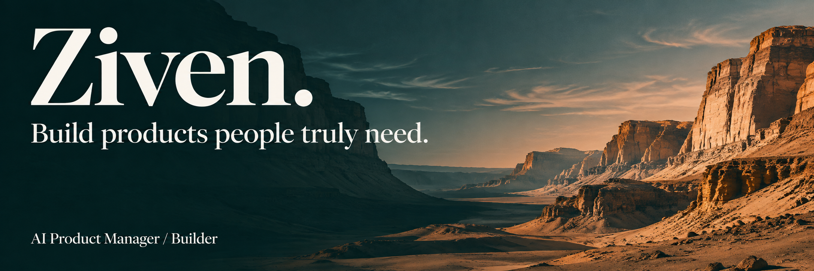
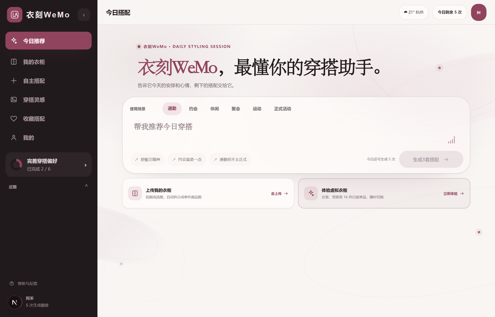
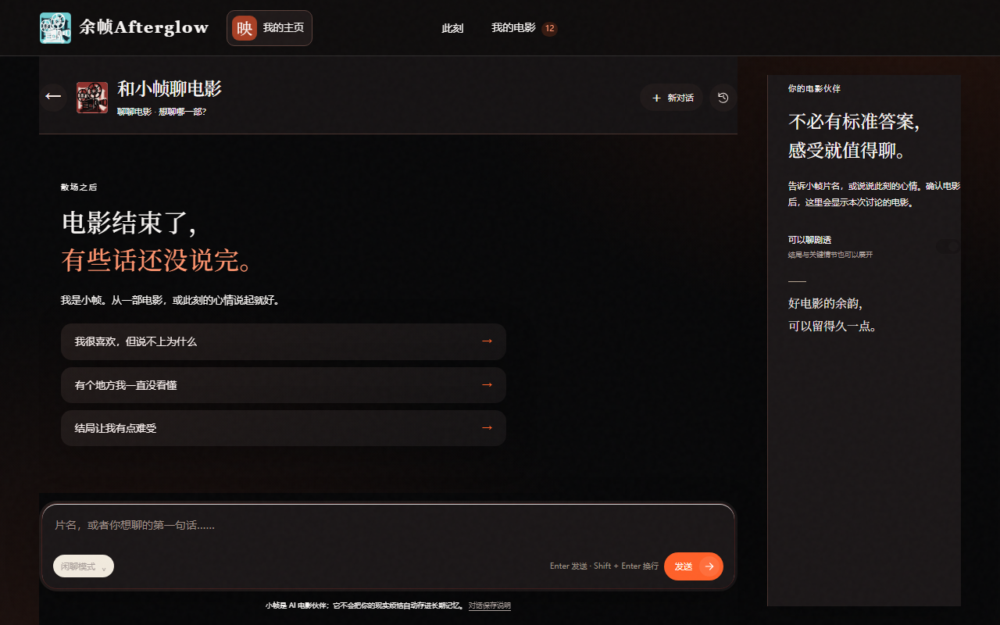
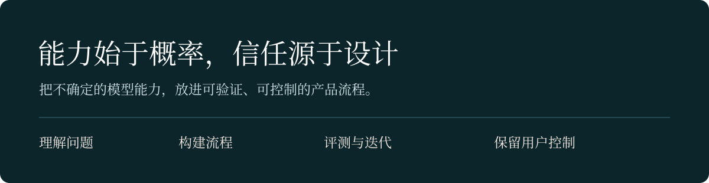

  <a href="https://se2r4cqrsivgd0rtradej.apigateway-cn-beijing.volceapi.com/">个人网站</a> &nbsp; / &nbsp;
  <a href="https://github.com/czm2952795093-star?tab=repositories">项目仓库</a> &nbsp; / &nbsp;
  <a href="https://www.woshipm.com/u/1623067">AI 阿铭 · 文章</a>

## 你好，我是 Ziven

AI 产品经理，也是一个喜欢动手验证想法的人。

从百度智能云的企业知识库与 Agent 方案，到大疆的智能客服评测，再到中国移动的智能出行 Agent，我一直在探索：**如何把模型的可能性，转化成用户能理解、能掌控的产品。**

工作之外，我独立设计、开发并上线 AI 应用，把产品工作中的方法沉淀为 Skills，也在「人人都是产品经理」记录体验与思考。

### Selected work · 把想法做成产品

#### 衣刻 WeMo

**从真实衣柜出发，让每一次穿搭都能落地。**

一款面向手机的 AI 衣柜与穿搭助手。把照片中的衣物识别、衣柜管理、穿搭推荐与虚拟试穿连起来，探索 AI 如何解决每天都会遇到的小问题。

从用户研究、产品设计到开发上线与反馈迭代，完整走一遍产品闭环。

[查看源码](https://github.com/czm2952795093-star/WeMo) · [在线体验（需邀请码）](https://s7nflqv16lurrohpcvegk.apigateway-cn-beijing.volceapi.com/)

 

#### 余帧 Afterglow

**电影散场以后，你的感受还有下文。**

一个记得你电影经验的 AI 电影伙伴。从选片、看后讨论到多次观影的感悟沉淀，让推荐有来处，让记忆可见、可修改、可删除。

我在这个产品里关注的，是长期记忆、推荐依据与用户控制权如何一起成立。

[查看源码](https://github.com/czm2952795093-star/Afterglow) · [在线体验](https://scjr6ugp5e1uskemefhmn.apigateway-cn-beijing.volceapi.com/)

 

#### 也在做这些工具

| 项目 | 解决的问题 |
| :--- | :--- |
| [AIPM Skills](https://github.com/czm2952795093-star/AIPM-skill) | 从用户痛点、商业判断、市场分析到 PRD，把产品工作串成可复用的 AI 工作流。 |
| [Image to Prompt](https://github.com/czm2952795093-star/Image-to-Prompt) | 右键图片生成结构化图像提示词，缩短从视觉参考到 AI 创作的距离。 |
| [RePDF Studio](https://github.com/czm2952795093-star/RePDF-Studio) | 把图片、扫描件和 PDF 还原为可编辑图层，再导出可选中文字的 PDF。 |
| [Zivion](https://github.com/czm2952795093-star/Zivion) | Android 离线紫微排盘与记录工具，探索复杂信息的分层呈现与本地数据管理。 |

 

### Experience · 从方案到验证

| 经历 | 关注与实践 |
| :--- | :--- |
| **中国移动** · AI 产品实习 | 智能出行 Agent；梳理多 Agent 职责与调度逻辑，搭建 POC，参与模型选型与效果评测。 |
| **大疆创新** · AI 产品实习 | 官网智能客服；构建离线评测集，结合错误案例优化 Prompt、场景路由与人工接管规则。 |
| **百度智能云** · AI 产品实习 | 企业智能辅助平台；参与 RAG 知识库、报告生成与合同审核 Agent 的产品方案设计。 |

这些经历让我形成了同一个习惯：先明确什么是好结果，再通过评测和真实反馈推动迭代。

### Notes & perspectives · 实践之外，继续追问

我以「AI 阿铭」的名字写作，关注 Agent 产品、模型体验、产品判断与知识管理。

- [AI持续学习火了：下一代智能体拼的不是“会回答”，而是“会积累”](https://www.woshipm.com/ai/6438276.html)  
  从外部记忆到流程学习，思考长期协作中的记忆管理与用户控制。
- [当国产大模型杀入编程「决赛圈」：一个产品经理的冷思考](https://www.woshipm.com/ai/6372886.html)  
  当执行越来越容易，重新审视产品判断与场景理解的价值。
- [Google Stitch：我测了3天，它可能会让UI设计师开始焦虑](https://www.woshipm.com/share/6365884.html)  
  从工具体验出发，观察 AI 如何改变设计与产品协作。
- [NotebookLM：我用了30天，它重新定义了我的知识管理方式](https://www.woshipm.com/ai/6365883.html)  
  从收藏资料走向理解、关联和使用知识。

[阅读更多文章](https://www.woshipm.com/u/1623067)

 

---

**当答案唾手可得，提出好问题的能力便愈显珍贵。**

有意思的问题，值得一起研究。欢迎通过 [GitHub](https://github.com/czm2952795093-star) 或[文章主页](https://www.woshipm.com/u/1623067)交流。
